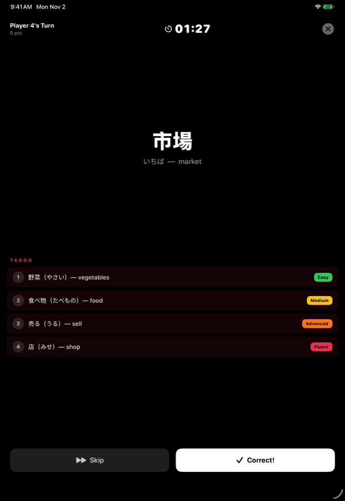
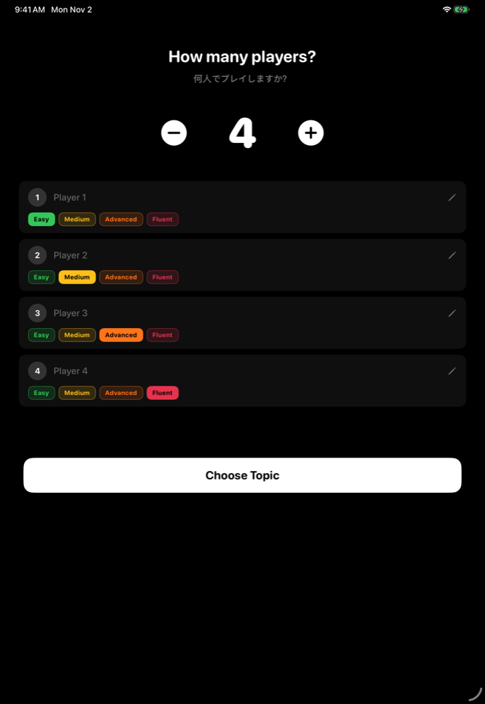
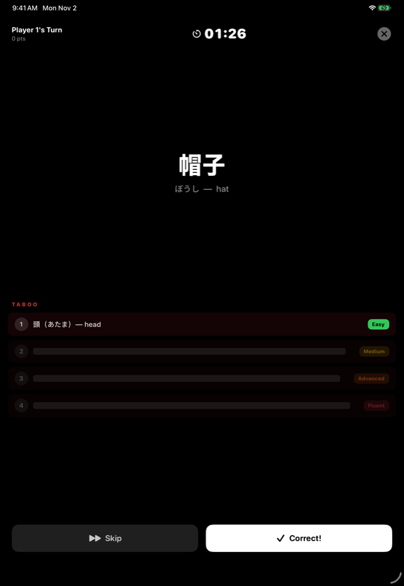
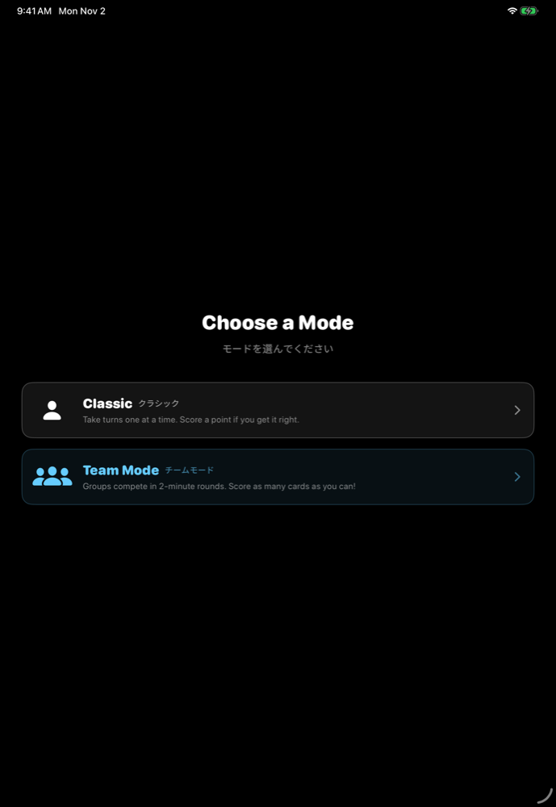
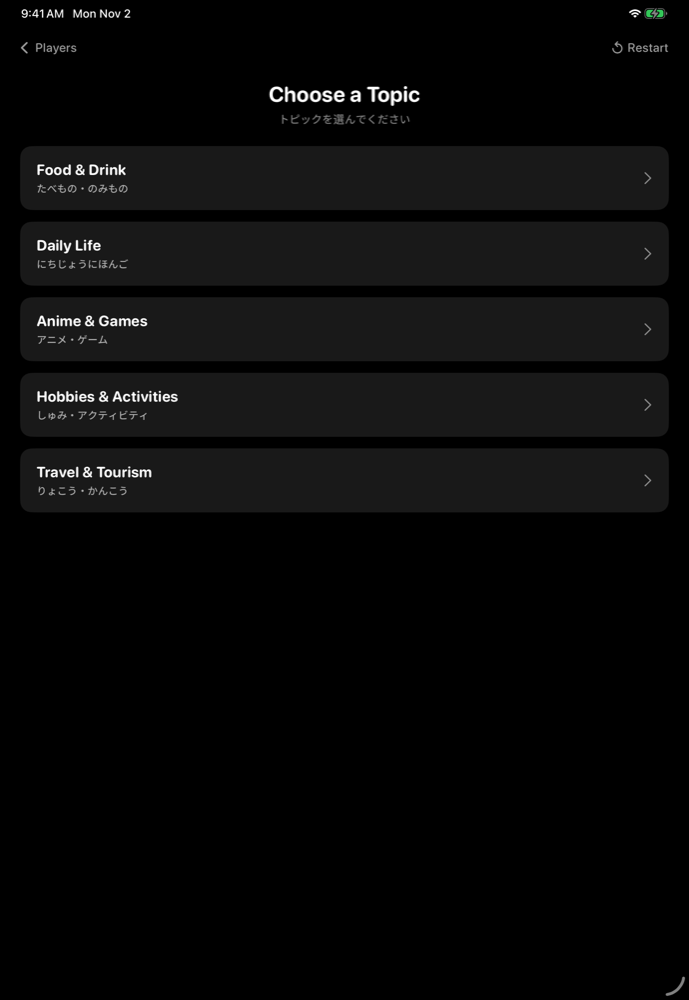
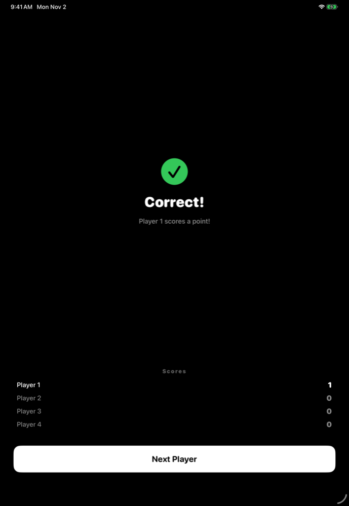

# Japanese Taboo

**A party game for practicing spoken Japanese with friends, on one iPhone, iPad or Mac.**

Describe a Japanese word to your group without saying any of its forbidden "taboo" words.
It's the classic party-game format, adapted for language learners: every player sets their
own difficulty, so beginners and fluent speakers can play at the same table.

<p align="center">
  
  &nbsp;
  
</p>

## Why I built it

**Language learning is social.** A lot of people learn a language to connect with other
people, which is why live, in-person practice works better than practicing alone with an app.
So instead of building another solo study tool, I wanted to make the in-person experience better.

**At Japanese meetups, the same conversations happen on repeat.** Where are you from? What do
you do? Why are you learning Japanese? People fall back on the phrases they've rehearsed
most, so they get comfortable without actually improving.

**Taboo breaks those loops.** It makes a meetup more fun and pushes people off their most
rehearsed conversation paths:

- **You can't use the obvious words.** Describing 寿司 (sushi) without saying fish, rice,
  Japan or raw forces you to paraphrase, build new sentences and reach for vocabulary you
  don't normally use.
- **It's live and social.** One shared iPad on the table, a timer, and the whole group
  guessing. The energy comes from the room, not the app.
- **It works for mixed levels.** Meetups always span beginners to near-fluent speakers.
  Each player picks their own difficulty, which decides how many taboo words they have to
  avoid, so everyone is stretched just past their comfort zone in the same game.

### Topics chosen for the conversations they create

The five decks aren't just vocabulary lists. Each was chosen for the kind of talk it produces:

| Topic | Why it's there |
| --- | --- |
| **Daily Life** | High-frequency words and everyday objects. The easy entry point, built for confidence and flow rather than challenge |
| **Food & Drink** | Visual, culturally rich and easy to describe. It sparks opinions, comparisons and memories |
| **Anime & Games** | Iconic characters and franchises people love. Strong fandom energy, which makes it the most social deck |
| **Hobbies & Activities** | Verbs and routines force full sentences and explanations, the closest to real conversation |
| **Travel & Tourism** | Onsen, festivals, the bullet train: storytelling and recommendations, and often the reason people learn Japanese in the first place |

## How to play

1. **Choose a mode and set up.** Classic mode takes up to 20 players, each with their own
   difficulty. Team mode takes 2–6 teams.
2. **Pick a topic** to build the deck from.
3. **Pass the device** to whoever is up. They see the target word, plus the taboo words
   they're not allowed to say.
4. **Describe the word in Japanese** before the timer runs out. Skip a card and it goes back
   into the deck.
5. **Most points wins.** The final screen shows a ranked scoreboard.

| Mode | How a turn works |
| --- | --- |
| **Classic** | Each player gets one card and 90 seconds, and scores a point if the group guesses it |
| **Team** | Teams race through as many cards as they can before time runs out (30 seconds to 5 minutes, set before the game); every correct guess is a point |

## Difficulty: more forbidden words

Each card has a target word and four taboo words, ordered from the most obvious clue to the
hardest to avoid. Difficulty sets how many of them the player has to steer around:

| Difficulty | Taboo words in play |
| --- | --- |
| Easy | 1 |
| Medium | 2 |
| Advanced | 3 |
| Fluent | 4 |

<p align="center">
  
  &nbsp;
  
  <br>
  <em>The same game, two players: Easy sees one taboo word, Fluent has to avoid all four.</em>
</p>

Players set their own level, so a beginner on Easy and a fluent speaker on Fluent can take
turns in the same game fairly.

## Cards

**267 hand-written cards** across five topics:

| Topic | Cards |
| --- | --- |
| Food & Drink (たべもの・のみもの) | 55 |
| Daily Life (にちじょうにほんご) | 63 |
| Anime & Games (アニメ・ゲーム) | 52 |
| Hobbies & Activities (しゅみ・アクティビティ) | 47 |
| Travel & Tourism (りょこう・かんこう) | 50 |

Every word shows its **reading in hiragana** and an English translation, so players can
still read cards that are above their level. For example, the card for
寿司 (すし, sushi) bans 魚 (fish), 米 (rice), 日本 (Japan) and 生 (raw).

## More screens

| Home | Modes | Topics | Turn result |
| --- | --- | --- | --- |
|  |  |  |  |

## Built with

- **SwiftUI**, one codebase for iPhone, iPad, Mac and Apple Vision Pro
- A single `NavigationStack` driven by an `AppRoute` enum, with all game state in one
  `ObservableObject` (`GameSession`)
- No network, accounts or tracking: everything runs on the device

## Running it

Requires Xcode 26 or later (iOS 26.4 / macOS 26.3 SDK).

1. Open `Jenolingo v3.xcodeproj` in Xcode.
2. Pick an iPhone, iPad or Mac destination.
3. Press **Run** (Cmd+R).

## Project structure

```
Jenolingo v3/
├── Models/   Game state, players, teams, topics, difficulty, card types
├── Data/     The 267 cards, one file per topic
└── Views/    Setup, turn, results and scoreboard screens for Classic and Team modes
```

## Part of a series

Japanese Taboo is the third of my language-learning apps, after **Jenolingo** (adaptive
Indonesian reading comprehension) and **Speak with Arjun** (a voice conversation tutor for
Indonesian).
